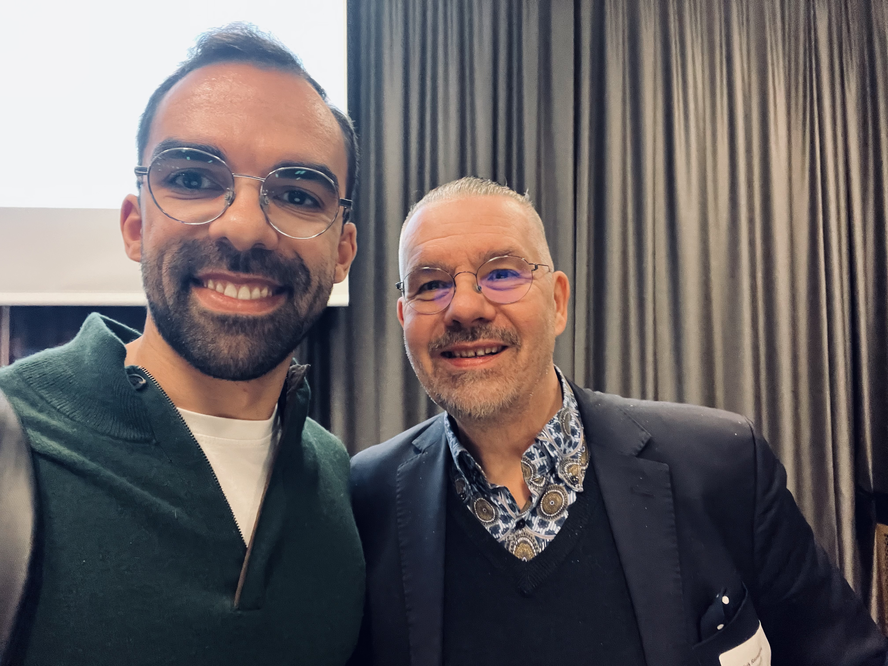
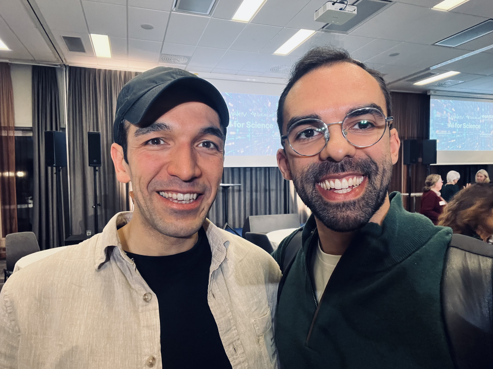
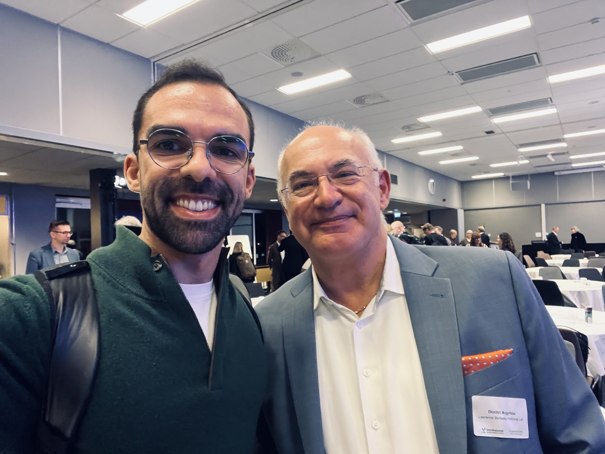

***I took a bit of a gamble!***

Last week I attended the [2026 AI for Science Summit](https://www.maxiv.lu.se/event/ess-max-iv-scilifelab-summit-2026-ai-for-science-connecting-research-data-and-infrastructure/) in Linköping, Sweden, organised jointly by ESS, MAX IV, and SciLifeLab.

Ahead of the conference, I was fearful that it might be a poor fit, that I might be out of place, due to its focus on Swedish national strategy and life sciences. I would have to travel more than 3000 kilometres, all the way from Portugal to Sweden, with a 2 hour train from Stockholm to Linköping (very comfortable, may I say) - quite the commitment.

Thankfully, my fears were proved wrong. Through Sweden’s current challenges in keeping up with the rapidly evolving AI landscape, I was able to gain valuable insight into the role of funding, institutions, infrastructure and, perhaps most importantly, people in driving change.

Here are three key takeaways from the 2026 Summit on AI for Science.

, was installed by [the National Academic Infrastructure for Supercomputing in Sweden (NAISS), together with the EuroHPC Joint Undertaking](https://www.eurohpc-ju.europa.eu/eurohpc-ju-inaugurates-arrhenius-new-mid-range-supercomputer-together-naiss-sweden-2026-09-08_en). Photo taken during my tour of the NAISS supercomputing installations, as part of the conference, on the 9th of November, 2026.](images/arrhenius.png)

## Feel the urgency

If I wasn’t confident in this fact already, it became very clear to me that a sense of urgency should prevail. Despite all the speculation, all the unprofitable AI startups, the price wars, the rising interest rates - the AI revolution is here to stay, and would need a hard hit to slow down any time soon.

To begin with, I learned at the conference that for some one infrastructure provider, research demand for GPUs is outpacing providers 3 to 1. For another - it’s 5 to 1. And these aren’t speculative startups selling vapourware - they’re academics who require the compute for their research.

There is no room for a “The scientists must be wrong!” moment, here. This is a “Everyone and their mother would have to be wrong about everything for this to be a nothing burger.” moment.

So what should you do to keep up? Unfortunately, futurology is of very little use to us here, and the biggest concern is definitely that no one really knows and the path is yet to be charted. At the conference, the general consensus seemed to be that everyone should be doing *something* with AI, they should *prioritise* it, and they should do it *fast*.

Feel the way forward, if you have to. The opportunity cost is real.

## The sovereignty trade-off

When leveraging AI products, users should maintain awareness at all times that whatever they do is almost certainly being used to train the next generation of frontier models. That means the data, the work, the ideas, the user experience, just about everything.

The extent to which this poses a problem is, of course, up to the user (and whomever could make the user liable for irresponsible use of these AI models). If the user is working with sensitive information, it might be a bad idea (if not outright illegal) to use a commercial product like ChatGPT or Claude Code. Likewise, the solution to adopt depends on the circumstances.

For a research institution, for example, the best option might be to host models locally, not only with the aim of providing cheaper inference for the researchers, but to fine tune it on all the data produced in the research lifecycle. At a certain scale, institutions might even be best advised to train their own frontier models. At the very least, prioritising sovereignty buys, besides a miriad of technical and legal complications, the peace of mind of knowing that you aren’t paying hefty subscriptions for your data to be stolen and the next generation of automatons to be trained on your own work.

## Leave humans behind at your own risk

The latest news from the field of mathematics show that humans aren’t leaving any time soon.
Indeed, on October 6, 2026, OpenAI released a massive batch of 722 AI-generated mathematics preprints (often called the ["mathocalypse"](https://retractionwatch.com/2026/10/08/openai-withdraws-preprints-722-manuscripts-unsolved-math-problems/)). However, in just 31 hours, three of the papers were widthdrawn due to gross errors.

In his keynote speech at the summit, Dimitri Argyriou, Director of the Advanced Light Source facility of the Lawrence Berkeley National Laboratory (University of California), noted:

> Answers are cheap, proofs are not.

AI can provide answers, but it isn’t (for the time being) capable of injecting the *why* into our brains. For the foreseeable future, we will still need humans to understand how agentic AI arrived at solutions and why they worked. The level of criticality in understanding the “vibe-solution” at hands varies, of course, with the use case and the user’s own demands: whereas an academic researcher might be pressed to keep the AI’s methodology explainable or, at the very least, cogniscible in the context of the existing body of knowledge, someone working in the industry might find it acceptable to simply certify the correctness of the answer.

It is now perfectly clear that jobs will change - even more than what they’ve changed already. The role of humans is, increasingly, that of certifiers of work done by AI. One might expect this to absolve the human of responsibility for the AI’s actions, but it’s quite the opposite. There is a growing demand for humans that know how to use these systems and can ensure that their output is up to standards and requirements.

Paraphrasing Dimitri Argyriou, in his keynote speech:

> Science was never advanced by checking the answers at the back of the book.

In the new AI age, it is up to the humans to own the question and, at the very least, understand the answer. Now, more than ever, if we are to thrive in this new environment, we must fight our urge to cheat our way through these testing times.

---

I credit the speakers and attendees at the conference for the insightful conversations that helped shape this piece. Ironically, I wrote it using no AI, on the 17:27 return train from Linköping to Stockholm, Sweden.

